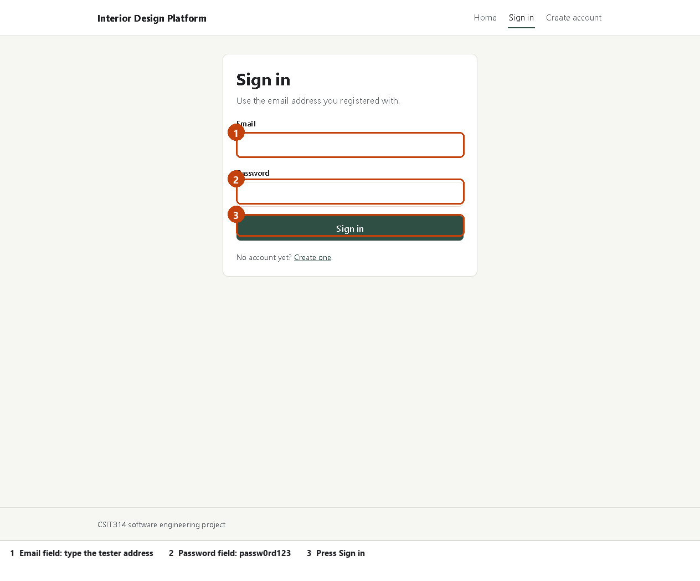
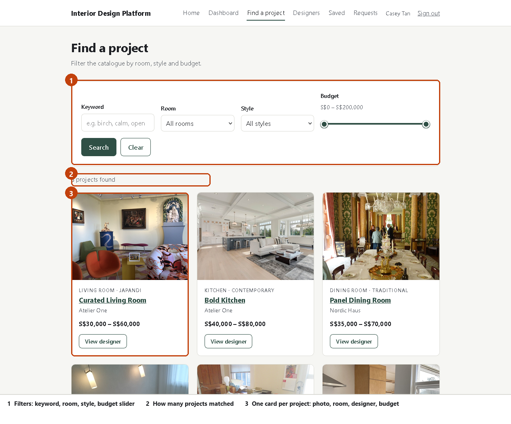
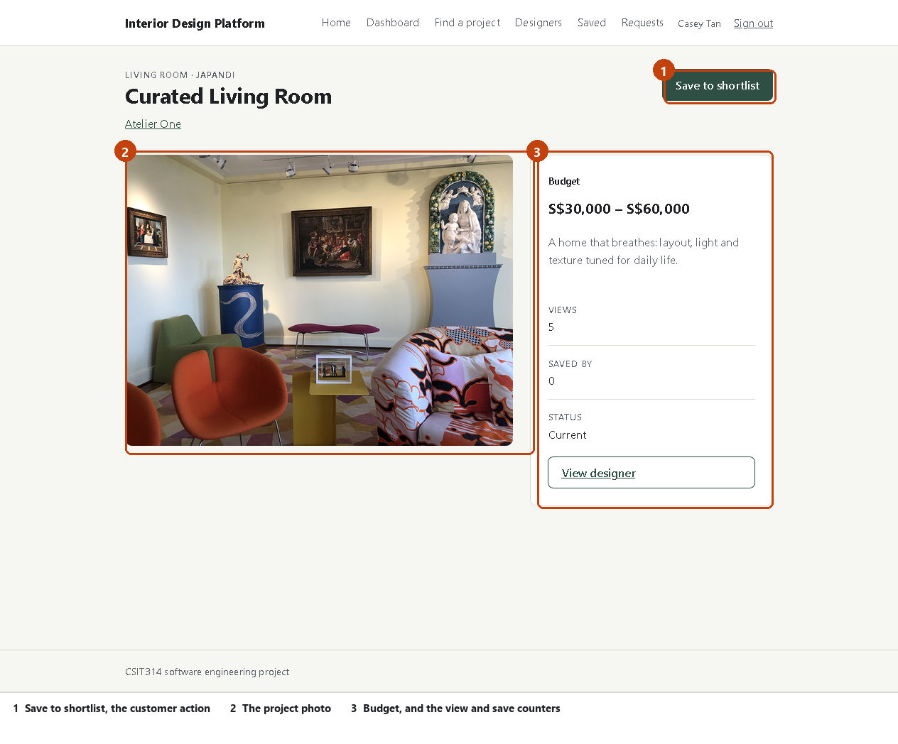
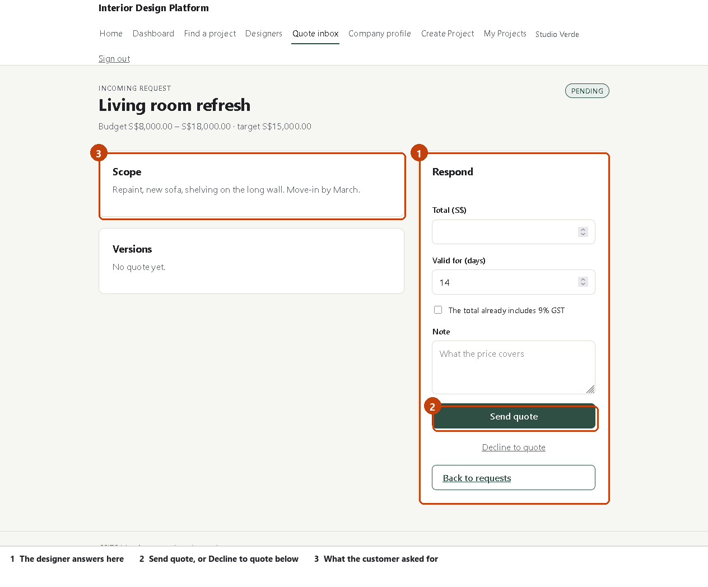
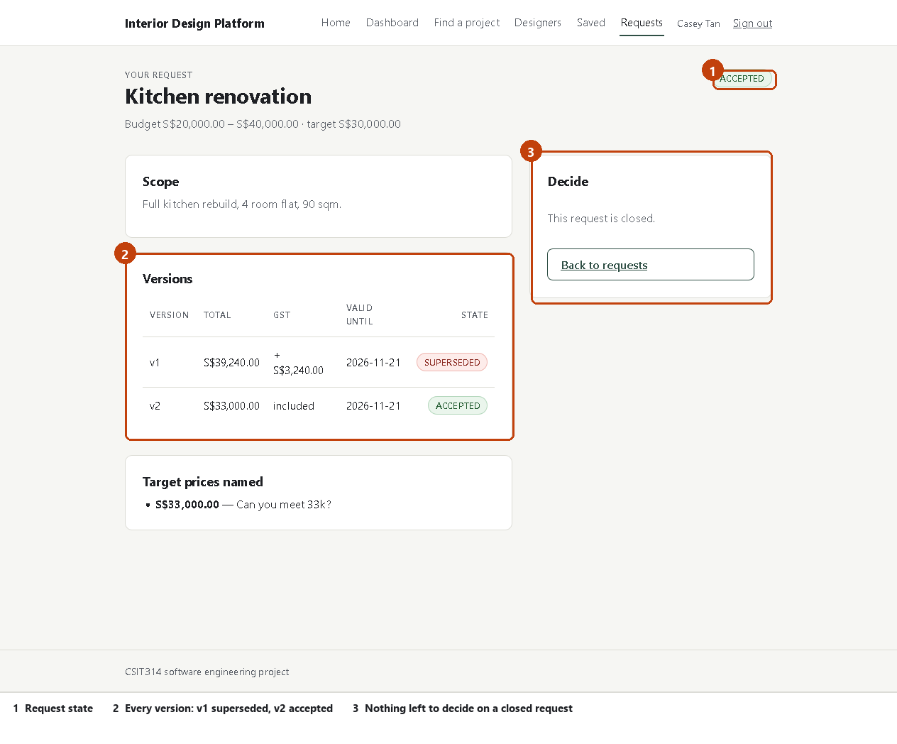
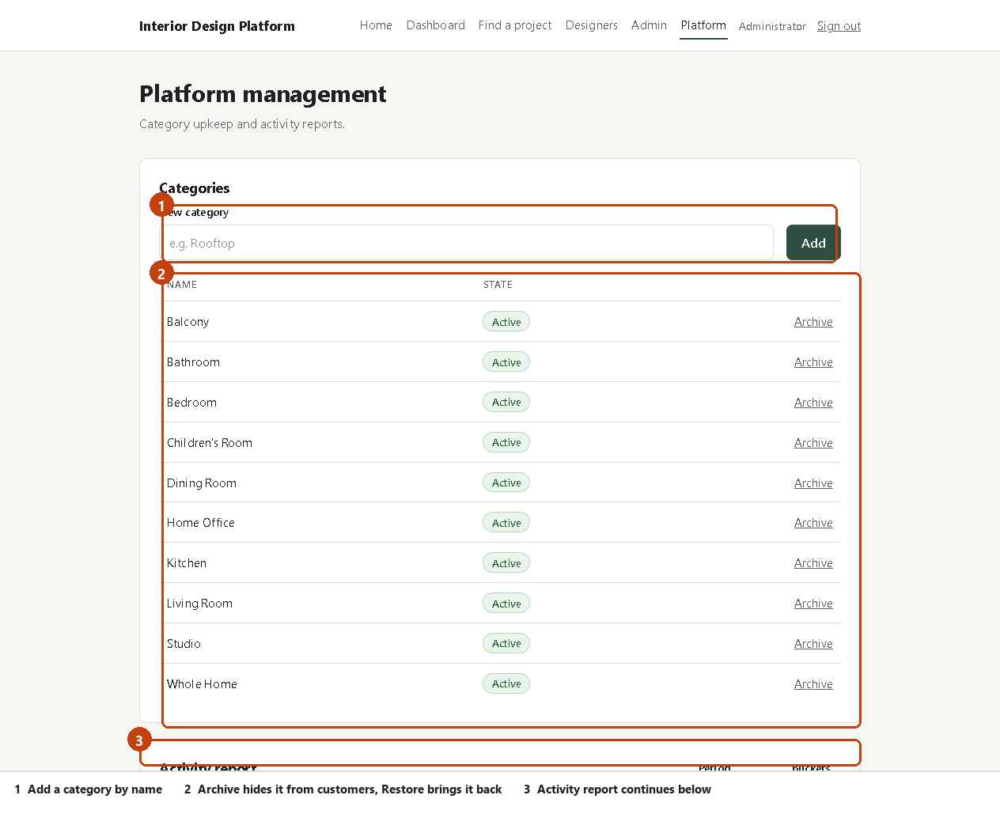

# Testing guide

Thank you for testing the Interior Design Platform. This guide takes you from a
fresh computer to a working app in about 20 minutes. You do not need to know how
to code. You double-click five files in order.

You need:

| Item | Detail |
|---|---|
| Windows | 10 or 11, 64-bit |
| Disk space | about 1.5 GB free |
| Internet | only while installing. The app itself runs offline. |
| Time | 20 minutes for the first run |

---

## 1. Get the project onto your computer

1. Press the Windows key, type `powershell`, and press Enter.
2. Copy the line below, paste it into the blue window, and press Enter.

```
git clone https://github.com/drk-cell/CSIT314-InteriorDesignWebsite.git
```

Wait for it to finish. It creates a folder called
`CSIT314-InteriorDesignWebsite` in your user folder, for example
`C:\Users\YourName\CSIT314-InteriorDesignWebsite`.

> If the window says `git is not recognised`, install Git from
> https://git-scm.com/download/win first, using the default options, then open a
> new PowerShell window and try again.

**If you downloaded a ZIP instead of cloning:** right-click the ZIP, choose
Extract All, and open the extracted folder. Windows may mark the batch files as
blocked. If a batch file opens and closes at once, right-click it, choose
Properties, tick `Unblock` at the bottom, and press OK.

## 2. The five files

All five sit in the top folder of the project. Run them in order. Each one prints
what it is doing, and each one waits at the end so you can read it.

| File | What it does | How long |
|---|---|---|
| `1-check-my-pc.bat` | checks Git, Node.js and Python are installed | 5 seconds |
| `2-install.bat` | downloads the pieces the app needs | 2 to 5 minutes |
| `3-start-app.bat` | starts the app and opens your browser | 20 seconds |
| `4-load-demo-data.bat` | fills the app with example designers and projects | 15 seconds |
| `5-stop-app.bat` | closes the app when you finish | 5 seconds |

## 3. Check your computer

Double-click **`1-check-my-pc.bat`**.

A black window appears. Every line should say `[OK]`. It must look like this:

```
  [OK]      git version 2.52.0.windows.1
  [OK]      Node.js v22.23.2
  [OK]      Python 3.11.16

  All three tools are present. You can run 2-install.bat.
```

If a line says `[MISSING]`, install that tool from the address printed beside it,
then run this file again. Do not continue until every line is `[OK]`.

Two easy mistakes:

- Node.js: choose the **LTS** installer, not Current.
- Python: on the first screen, tick **Add python.exe to PATH**. If you miss it,
  uninstall Python and run the installer again.

## 4. Install

Double-click **`2-install.bat`**. Text scrolls for a few minutes. That is normal.

Wait for these two lines:

```
  INSTALL FINISHED.
  Next: double-click 3-start-app.bat
```

If you see `INSTALL STOPPED`, copy the last 20 lines of the window and send them
to the person who asked you to test. Do not retry more than once.

## 5. Start the app

Double-click **`3-start-app.bat`**.

Two black windows open. They are the app running. **Leave both open.** If you
close them, the app stops. Your browser opens by itself at
`http://localhost:5173`.

Windows may ask whether to allow Python to use the network. Press **Allow**.

## 6. Load the example data

Double-click **`4-load-demo-data.bat`** and press **D**.

You should see:

```
seeded Studio Verde: 3 projects
seeded Nordic Haus: 3 projects
seeded Atelier One: 2 projects
seeded customer: casey@example.com
```

The data lives in memory. Every time you restart the app with `3-start-app.bat`,
run this file again. Otherwise the app starts empty.

## 7. Sign in

Go back to the browser. You see the sign-in page.



| Account | Password | Role |
|---|---|---|
| `casey@example.com` | `passw0rd123` | customer |
| `verde@example.com` | `passw0rd123` | designer, Studio Verde |
| `nordic@example.com` | `passw0rd123` | designer, Nordic Haus |
| `admin@example.com` | `passw0rd123` | platform staff |

Use `casey@example.com` for the customer tests.

---

# What to test

Six short tasks. After each one, compare what you see with the screenshot. If
something differs, that is a finding, not your mistake.

## Task 1: search as a customer

Sign in as `casey@example.com`. Press **Find a project** in the top bar.



1. Set **Room** to `Bedroom`. The list narrows as soon as you choose.
2. Drag the budget handles so the range is about S$20,000 to S$60,000.
3. Press **Search**, then **Clear**.

What should happen: the count line is always above the cards. Clear puts every
filter back. Nothing should feel stuck or slow.

## Task 2: open a project and save it

Press a project name, for example **Curated Living Room**.



1. Read the budget and the counters on the right.
2. Press **Save to shortlist**. The button changes to `Saved — remove`.
3. Press **Saved** in the top bar. Your project is listed.
4. Press **Remove** there, then reload the project page.

What should happen: the Saved by counter goes from 0 to 1 after you save, and back
to 0 after you remove. The Views counter rises each time you open the page.

## Task 3: ask a designer for a price

1. Press **Designers** in the top bar, then open **Studio Verde**.
2. Press **Request a quote**.
3. Fill in: title `Kitchen test`, scope `Repaint and new cabinets, 4 room flat`,
   budget floor `20000`, ceiling `40000`, target `35000`.
4. Press **Send request**.

What should happen: you land on your request page, state `PENDING`, with the
target price shown under the budget line. Sending a second request to the same
designer is refused with a clear message. That is intended.

## Task 4: see the answer and accept it

Sign in as `verde@example.com`. Press **Quote inbox**. Open `Kitchen test`.



1. Type a total, for example `38000`.
2. Leave the validity at `14` days and the GST box clear.
3. Press **Send quote**.

Then sign in again as `casey@example.com`, open **Requests**, and open the same
request.



1. Read the version table: one row, `OFFERED`, with the total plus 9% GST.
2. Type a target price of `35000` and press **Send target**.
3. Sign in as `verde@example.com`, open the request, and send a new version at
   `35000` with the GST box ticked.
4. Sign in as `casey@example.com` and press **Accept quote**.

What should happen: the old version turns `SUPERSEDED`, the new one becomes
`ACCEPTED`, and the request closes. Any other open request you sent stays open.
That is deliberate.

## Task 5: manage the catalogue as staff

Sign in as `admin@example.com`. Press **Platform** in the top bar.



1. Type `Rooftop` and press **Add**.
2. Sign in as `casey@example.com` and check the Room dropdown on the search page.
   `Rooftop` is there.
3. Sign back in as `admin@example.com`, press **Archive** beside `Rooftop`.
4. Check the customer dropdown again. `Rooftop` is gone.
5. Scroll down and change **Period** to weekly, then monthly.

What should happen: a category you archive disappears from the customer dropdown
but stays in the staff list, so you can restore it.

## Task 6: try to break it

Try these on purpose. Each one should give a clear message, never a blank screen
and never a crash.

| Try this | Expected |
|---|---|
| Sign in with the wrong password | `Invalid email or password` |
| Send a quote request with an empty title | the form refuses to submit |
| Open a quote with a total of `0` | `Enter a total above zero` |
| Open a project page with a made-up address | a "not found" message and a Back link |
| Press browser Back and Forward several times | the app keeps working |
| Reload the page while signed in | you stay signed in |

---

# Report what you find

Send one message per problem, with these four lines:

```
What I did:       (for example: pressed Save to shortlist on Curated Living Room)
What I expected:  the button says Saved, the counter shows 1
What happened:    the page went blank after half a second
Screenshot:       attached, taken after the problem
```

Screenshots help more than descriptions. Press `Windows + Shift + S` to snip one.

Two things that are **not** bugs, so you do not need to report them:

1. All data disappears when you run `5-stop-app.bat`. The app keeps data in
   memory on purpose. Run `4-load-demo-data.bat` after each start.
2. Photos repeat across projects. The example data reuses 16 photographs.

# If something goes wrong

| What you see | What to do |
|---|---|
| `'git' / 'node' / 'python' is not recognised` | install that tool, then **open a new** black window. Windows only sees new tools in new windows. |
| `EADDRINUSE` or `port 8000 is already in use` | run `5-stop-app.bat`, then `3-start-app.bat` again |
| The page says it cannot reach the server | wait 20 seconds, press F5. If it stays, close both black windows and run `3-start-app.bat` again. |
| A blank white page | press F5. If it stays blank, send the address in the browser bar. |
| `npm install` fails with a network error | check your internet, then run `2-install.bat` again |
| The browser opens before the app is ready | wait 20 seconds and press F5 |

# When you finish

Double-click **`5-stop-app.bat`**. It closes both windows and frees the ports.
Your browser tab will stop working, which is expected.

To test again later: `3-start-app.bat`, then `4-load-demo-data.bat`.
